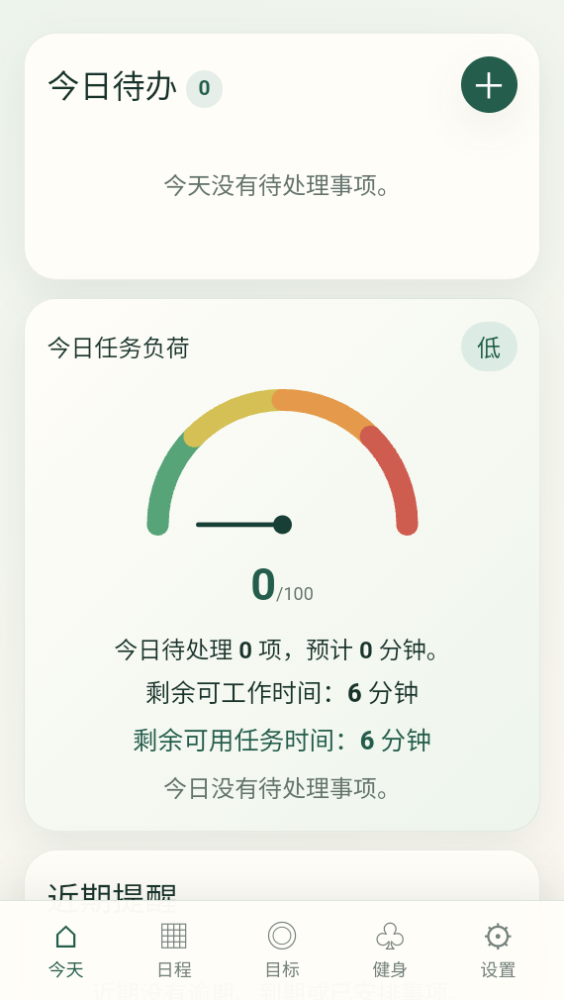
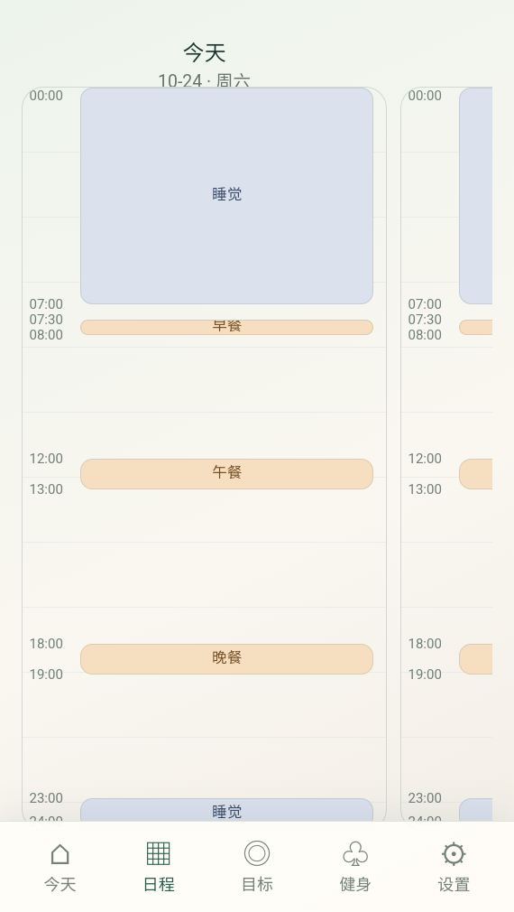
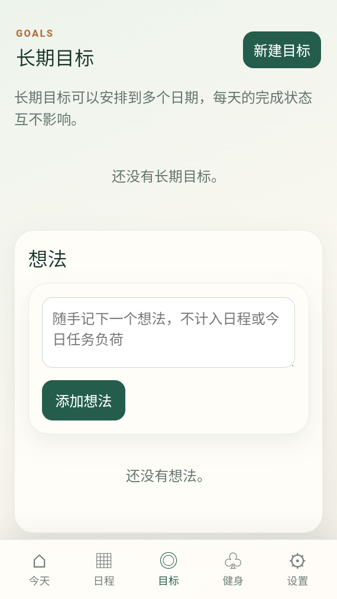
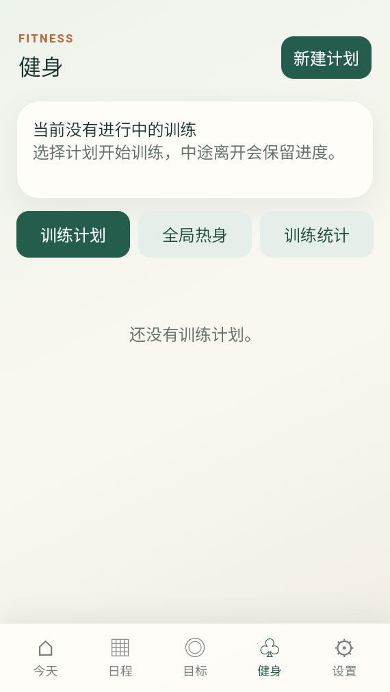
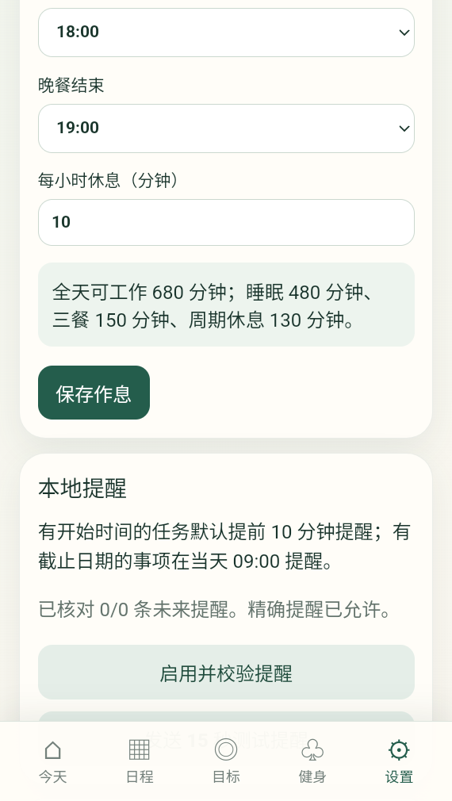

# zuocai

一个离线优先的 Android 待办与训练记录应用。

zuocai 将待办、日程、时间负荷、训练计划、训练记录、休息计时、提醒和本地备份放在同一个手机 App 中。数据保存在 Android 本地数据库，应用没有自己的云端账号或同步服务。

## 功能

- 待办事项、截止日期、长期计划和日程安排
- 今日任务负荷与作息容量估算
- 训练计划、热身、组数记录和休息计时
- 本地提醒、训练统计和 CSV 导出
- JSON 备份与恢复，导入失败时事务回滚
- Android 生命周期恢复和离线使用

## 界面预览

以下截图来自 `zuocai` Android App，展示主要页面和使用入口。截图只用于项目预览，不包含真实账户、任务数据库或备份文件。

| 今日 | 日程 |
| --- | --- |
|  |  |

| 长期目标 | 健身 |
| --- | --- |
|  |  |

| 设置 |
| --- |
|  |

## 开发

环境要求：Node.js 24、pnpm、JDK 21、Android SDK Platform 35 和 Build Tools 35。

```powershell
pnpm install --frozen-lockfile
pnpm run test
pnpm run check
pnpm run build
pnpm exec cap sync android
```

在 Android Studio 中打开 `android/`，或运行：

```powershell
.\android\gradlew.bat assembleDebug
```

如果需要使用本机集中管理的 SDK、JDK 和 Gradle 缓存，可以从项目根目录运行：

```powershell
.\scripts\dev.ps1 test
.\scripts\dev.ps1 build
```

脚本只读取本机环境，不会把路径、数据库、签名或构建缓存写入仓库。

## 安装 Android 版本

当前可安装版本为 `zuocai 1.4.2`。在 Android 手机上下载并打开下面的 APK 即可安装：

- [下载 zuocai-1.4.2.apk](releases/zuocai-1.4.2.apk)
- [查看 SHA-256 校验值](releases/zuocai-1.4.2.apk.sha256)

安装前请确认下载文件的 SHA-256 与校验文件一致。此 APK 是个人侧载版本，升级时请先在 App 内导出 JSON 备份，再使用相同签名覆盖安装；不要先卸载旧版本。

## 数据与隐私

应用数据保存在 Android 私有 SQLite 数据库中。应用不会主动上传待办、训练记录或备份文件；Android 系统是否执行设备备份由系统设置决定。

JSON 备份未加密，请只保存到自己信任的位置。项目源码不包含个人数据库、导出的备份、签名密钥或本机路径。

## 测试

```powershell
pnpm run test
pnpm run check
pnpm run build
```

测试使用内存数据库和模拟原生接口，不会读取真实手机数据。Android 真机通知、系统云备份和覆盖安装仍需要在目标设备上单独验收。

## 发布

发布前请运行全部测试，并检查 APK 的包名、版本号、签名和 SHA-256。公开发布时不要把数据库、备份文件、签名密钥或本机配置上传到仓库。

## 贡献

请先阅读 [CONTRIBUTING.md](CONTRIBUTING.md)。提交代码时不要加入数据库、备份、密钥、APK、构建目录或任何本机配置。

维护仓库时请参考 [维护指南](docs/maintenance.md)，其中包含截图替换、APK 发布、隐私检查和 GitHub 项目管理流程。

## 许可

本项目使用 MIT License，见 [LICENSE](LICENSE)。
